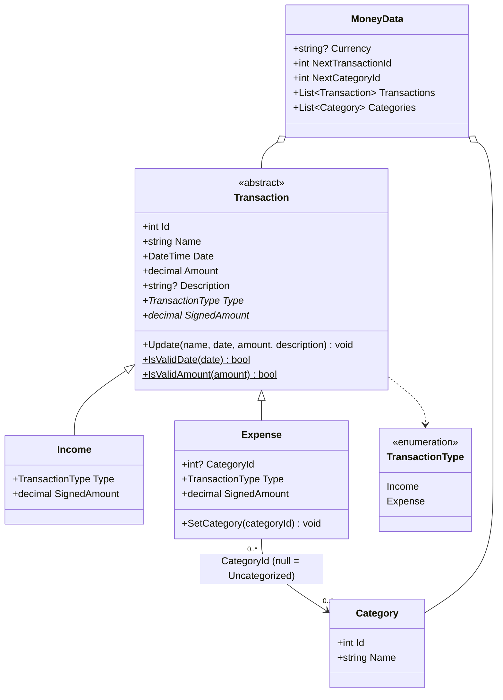
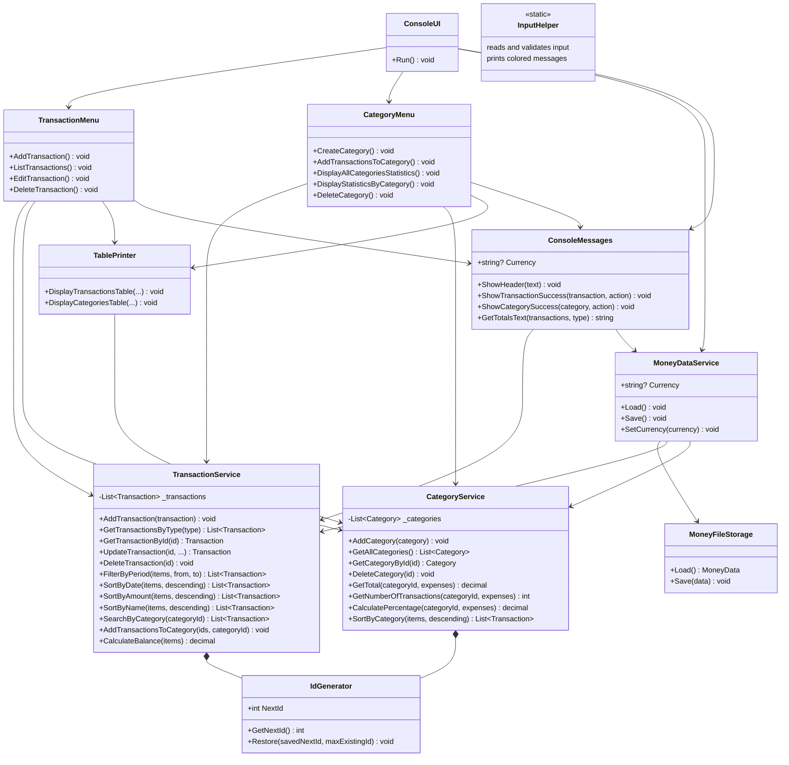

# Money Tracker

A C# console application for tracking personal incomes and expenses. You can add, list, edit and remove transactions, see only incomes or only expenses for all time or for a chosen period, sort them in ascending or descending order, group expenses into categories and see how much each category takes of all expenses. The balance is always shown above the menu, and all data is kept between runs in a JSON file.

## Description

The app answers two questions: *"How much money do I have left?"* and *"Where does my money go?"*. It was written as an individual course project (Money Tracking) to practise object-oriented programming (abstract classes, inheritance, polymorphism), LINQ filtering and sorting, `DateTime`, input validation, custom exceptions, working with files (JSON serialization) and splitting the code into classes with one responsibility each.

The code is split into layers, so that each class has one job:

- **Models** – `Transaction` is an abstract class with the data that every transaction has (id, name, date, amount, description) and validates it in its constructor and in `Update`. `Income` and `Expense` inherit from it; each of them decides its own `Type` and `SignedAmount` (`+Amount` for an income, `-Amount` for an expense). Only an `Expense` has a category (`CategoryId`, `null` = Uncategorized). `Category` is a group of expenses created by the user. `MoneyData` is what is saved to the file.
- **Services** – `TransactionService` holds the transaction list and works with it: add (with a new id), find by id, edit, delete, filter by type and period, sort, totals and balance. `CategoryService` holds the category list and calculates the category statistics. `MoneyDataService` loads all data from the file into both services, saves it back and keeps the app currency. `IdGenerator` gives out ids that are never reused. None of them writes to the console.
- **Data** – `MoneyFileStorage` writes `MoneyData` to a JSON file and reads it back.
- **UI** – `ConsoleUI` starts the app and shows the main menu. `TransactionMenu` contains menu items 1–4, `CategoryMenu` items 5–9. `TablePrinter` prints the tables, `ConsoleMessages` holds texts used by several menus (headers, success messages, totals), and `InputHelper` reads and validates user input and prints colored messages.
- **Exceptions** – custom exceptions (`ValidationException`, `TransactionNotFoundException`, `CategoryNotFoundException`, `UserCancelledException`, `InputClosedException`, `DataFileException`) carry error messages from the logic to the UI.

All objects are created in `Program.cs` and passed to each other through constructors (dependency injection), so the name of the data file is written in one place only.

### Technologies

- C# and .NET 10 console application
- `System.Text.Json` for saving and loading (with `[JsonPolymorphic]`, so the file knows whether an item is an `Income` or an `Expense`)
- LINQ for filtering, sorting and totals

## Features

- **Currency** – on the first start the app asks for the currency (3 Latin letters, e.g. `SEK`, `USD`, `EUR`). It is saved in the file and used in all amounts.
- **Balance above the menu** – `Balance`, `Incomes` and `Expenses` of all transactions are shown every time the menu appears.
- **Add transactions** – choose Income or Expense, enter name, date, amount and an optional description. Keep adding until you type `q` (works at any step). A new expense is *Uncategorized*; it is put into a category with menu item 6.
- **Ids** – every new transaction and every new category automatically gets the next number: 1, 2, 3… An id is never given out again, even after a delete or a restart.
- **Input validation** – name can't be empty (max 35 characters); the date must be in the format `yyyy-MM-dd` and can't be in the future; the amount must be greater than 0 with at most 2 decimals, and both a dot and a comma work as the decimal separator (`12.50` or `12,50`); description is optional (max 100 characters). On invalid input the app shows a message and asks again instead of crashing.
- **List transactions** – all, only incomes or only expenses:
  - **All time** (sorted by id) or a **period** (from – to, both days included, sorted by date). The app shows the first and the last date that exist, and Enter in *To* means "the same day as *From*".
  - Under the table: the totals of exactly the rows shown (balance for all, total income or total expenses).
  - After the table you can **sort it again** as many times as you want: by date, amount, name or category, ascending or descending. Transactions with the same value keep a stable order (the same date → by id, the same amount or name → by date).
  - In the table of all transactions incomes are positive and expenses are negative; the Category column shows `N/A` for incomes. The table of incomes has no Category column at all.
- **Edit transactions** – enter an id, check the transaction in a table, confirm with `y`. Every field shows its current value: press Enter to keep it, type a new value to change it, type `-` to clear the description.
- **Remove transactions** – enter an id, check the transaction, confirm with `y` or keep it with `n`.
- **Categories** (for expenses only):
  - **Create** – category names must be unique (ignoring upper/lower case).
  - **Add expenses to a category** – choose a category (or `0` – Uncategorized), then enter one or more expense ids separated by commas (`3, 4, 7`). All ids are checked first, so either all expenses get the category or none of them.
  - **Statistics of all categories** – total, number of expenses and percent of all expenses for each category, plus the *Uncategorized* row and the total under the table.
  - **Statistics of one category** – its statistics row and all its expenses with their total.
  - **Remove a category** – its expenses are **not** deleted, they become Uncategorized. *Uncategorized* itself is not a real category and can't be removed.
- **Save & load** – all data is saved to `moneyTracker.json` after every change and loaded automatically on start. If the file is missing (first run), the app starts with an empty list; if the file is corrupted or contains invalid data, the app shows a message and starts with an empty list instead of crashing.
- **Colored messages** – green for success, red for errors, yellow for warnings, magenta for information.

## Getting started

### Prerequisites

- [.NET 10 SDK](https://dotnet.microsoft.com/download)

### Installation

```bash
git clone https://github.com/alakhmakova/MoneyTracker.git
cd MoneyTracker/MoneyTracker
dotnet run
```

### Where the data file is

The data is saved in `moneyTracker.json` in the **folder the app is started from** (the current working directory). The file is in `.gitignore`, so a fresh clone has no data: the app asks for the currency and starts with an empty list.

| How you start the app | Where `moneyTracker.json` is |
|---|---|
| `dotnet run` inside `MoneyTracker/MoneyTracker` (as above) | `MoneyTracker/MoneyTracker/moneyTracker.json` |
| `dotnet run --project MoneyTracker` from the repository root | `MoneyTracker/moneyTracker.json` in the repository root |
| Visual Studio (F5) | `MoneyTracker/MoneyTracker/bin/Debug/net10.0/moneyTracker.json` |

## How data is saved and loaded

`MoneyDataService.Save()` collects everything into one `MoneyData` object and `MoneyFileStorage` writes it as JSON. `MoneyDataService.Load()` reads it back and gives the transactions and categories to the services. The file looks like this:

```json
{
  "Currency": "SEK",
  "NextTransactionId": 6,
  "NextCategoryId": 3,
  "Transactions": [
    {
      "$type": "Income",
      "Id": 1,
      "Name": "Salary",
      "Date": "2026-10-25T00:00:00",
      "Amount": 28500,
      "Description": "October salary"
    },
    {
      "$type": "Expense",
      "CategoryId": 1,
      "Id": 3,
      "Name": "Coop",
      "Date": "2026-10-20T00:00:00",
      "Amount": 418.75,
      "Description": null
    }
  ],
  "Categories": [
    { "Id": 1, "Name": "Food" },
    { "Id": 2, "Name": "Home" }
  ]
}
```

- `$type` tells the serializer which class to create: `Income` or `Expense`.
- `NextTransactionId` and `NextCategoryId` are saved, so ids are not reused after a restart. If the file was edited by hand and a saved number is too small, the app continues from the biggest existing id + 1.
- `Amount` is always positive. `Type` and `SignedAmount` are not saved (`[JsonIgnore]`): they come from the class itself.
- When loading, every transaction goes through the same constructor and validation as a new one, so invalid data in the file (for example a date in the future) is reported as a corrupted file instead of getting into the app.

## How to use

After start, the app loads the saved data and shows the main menu with the current balance. Type the number of an option and press Enter.

```
-------------
MONEY TRACKER
-------------
4 transactions loaded from file

Balance: 19238.95 SEK | Incomes: 28500.00 SEK | Expenses: -9261.05 SEK
1-Add Transaction
2-List Transactions (All/Incomes/Expenses)
3-Edit Transaction
4-Delete Transaction
5-Create Category
6-Add Transactions to the Category
7-Display All Categories Statistics
8-Display Statistics by Category
9-Delete Category
0-Quit
Select Option 0-9:
```

### 1 – Add a transaction

```
Select Option 0-9: 1
-----------------------------------------------
Add transaction | Enter q at any step to cancel
-----------------------------------------------
1-Income 2-Expense (q - back to menu): 2
Enter name (max 35 characters, q - cancel): Willys
Enter date yyyy-MM-dd (q - cancel): 2026-11-02
Enter amount in SEK (q - cancel): 642,30
Enter description (max 100 characters, Enter - skip, q - cancel):
The expense "Willys" with amount 642.30 SEK and date 2026-11-02 was successfully created

1-Income 2-Expense (q - back to menu): q
Back to main menu
```

### 2 – List transactions

Choose what to show and for which time, then sort the table as many times as you want. Type `q` to go back to the menu.

```
Select Option 0-9: 2
1-All 2-Incomes 3-Expenses (q - back to menu): 1
1-All time 2-Period (q - back to menu): 1
-----------------------------------------------------------------------
Id   Name      Date           Amount   Category        Description
-----------------------------------------------------------------------
1    Salary    2026-10-25   28500.00   N/A             October salary
2    Rent      2026-11-01   -8200.00   Home            November rent
3    Coop      2026-10-20    -418.75   Food
4    Willys    2026-11-02    -642.30   Food
5    Netflix   2026-10-15    -149.00   Uncategorized
-----------------------------------------------------------------------
 Balance: 19089.95 SEK | Incomes: 28500.00 SEK | Expenses: -9410.05 SEK
Sort by 1-Date 2-Amount 3-Name 4-Category (q - back to menu): 2
1-Ascending (oldest, smallest, A-Z) 2-Descending (newest, largest, Z-A) (q - back to menu): 2
-----------------------------------------------------------------------
Id   Name      Date           Amount   Category        Description
-----------------------------------------------------------------------
1    Salary    2026-10-25   28500.00   N/A             October salary
2    Rent      2026-11-01   -8200.00   Home            November rent
4    Willys    2026-11-02    -642.30   Food
3    Coop      2026-10-20    -418.75   Food
5    Netflix   2026-10-15    -149.00   Uncategorized
-----------------------------------------------------------------------
 Balance: 19089.95 SEK | Incomes: 28500.00 SEK | Expenses: -9410.05 SEK
Sort by 1-Date 2-Amount 3-Name 4-Category (q - back to menu): q
Back to main menu
```

Sorting by amount uses the amount without the sign, so "largest" means the biggest sum of money: the biggest expense (`-8200.00`) comes before the smaller ones.

Only expenses for October:

```
1-All 2-Incomes 3-Expenses (q - back to menu): 3
1-All time 2-Period (q - back to menu): 2
Available period is from 2026-10-15 to 2026-11-02
From yyyy-MM-dd (q - cancel): 2026-10-01
To yyyy-MM-dd (Enter - same as From 2026-10-01, q - cancel): 2026-10-31
-------------------------------------------------------------------
Id   Name      Date          Amount   Category        Description
-------------------------------------------------------------------
5    Netflix   2026-10-15   -149.00   Uncategorized
3    Coop      2026-10-20   -418.75   Food
-------------------------------------------------------------------
                                        Total expenses: -567.75 SEK
```

### 3 – Edit a transaction

```
Select Option 0-9: 3
------------------------------------------------
Edit transaction | Enter q at any step to cancel
------------------------------------------------
Enter transaction id to edit (q - back to menu): 5
-------------------------------------------------------------------
Id   Name      Date          Amount   Category        Description
-------------------------------------------------------------------
5    Netflix   2026-10-15   -149.00   Uncategorized
-------------------------------------------------------------------
Edit this transaction? (y/n): y
Name [Netflix] (max 35 characters, Enter - keep, q - cancel):
Date [2026-10-15] (yyyy-MM-dd, Enter - keep, q - cancel):
Amount [149.00] (Enter - keep, q - cancel): 159
Description [] (max 100 characters, Enter - keep, - to clear, q - cancel):
The expense "Netflix" with amount 159.00 SEK and date 2026-10-15 was successfully edited
```

The category of an expense is changed with menu item 6.

### 4 – Delete a transaction

```
Select Option 0-9: 4
--------------------------------------------------
Remove transaction | Enter q at any step to cancel
--------------------------------------------------
Enter transaction id to remove (q - back to menu): 5
-------------------------------------------------------------------
Id   Name      Date          Amount   Category        Description
-------------------------------------------------------------------
5    Netflix   2026-10-15   -159.00   Uncategorized
-------------------------------------------------------------------
Remove this transaction? (y/n): y
The expense "Netflix" with amount 159.00 SEK and date 2026-10-15 was successfully removed
```

### 5 – Create a category

```
Select Option 0-9: 5
-----------------------------------
Create category | Enter q to cancel
-----------------------------------
Enter category name (max 35 characters, q - cancel): Food
The category "Food" was successfully created

Enter category name (max 35 characters, q - cancel): q
Back to main menu
```

### 6 – Add expenses to a category

Choose the category, then enter the ids of the expenses. The expenses table is grouped by category, so it is easy to see where each expense is now.

```
Select Option 0-9: 6
------------------------------------------------
Id   Name              Total   Count         %
------------------------------------------------
1    Food               0.00       0     0.00%
2    Home               0.00       0     0.00%
0    Uncategorized   9410.05       4   100.00%
------------------------------------------------
Enter category id (0 - Uncategorized, q - back to menu): 1
Add expenses to the category "Food"? (y/n): y
----------------------------------------------------------------------
Id   Name      Date           Amount   Category        Description
----------------------------------------------------------------------
5    Netflix   2026-10-15    -149.00   Uncategorized
3    Coop      2026-10-20    -418.75   Uncategorized
2    Rent      2026-11-01   -8200.00   Uncategorized   November rent
4    Willys    2026-11-02    -642.30   Uncategorized
----------------------------------------------------------------------
Enter expense ids separated by commas, e.g. 12, 15, 20 (q - cancel): 3, 4
Expenses added to the category "Food": 2
```

Choosing `0` moves expenses back to Uncategorized.

### 7 – Statistics of all categories

```
Select Option 0-9: 7
-------------------------
All categories statistics
-------------------------
-----------------------------------------------
Id   Name              Total   Count        %
-----------------------------------------------
1    Food            1061.05       2   11.46%
2    Home            8200.00       1   88.54%
0    Uncategorized      0.00       0    0.00%
-----------------------------------------------
                   Total expenses: -9261.05 SEK
```

### 8 – Statistics of one category

```
Select Option 0-9: 8
------------------------------------------
Statistics by category | Enter q to cancel
------------------------------------------
(table of all categories)
Enter category id (0 - Uncategorized, q - back to menu): 1
--------------------------------------
Id   Name     Total   Count        %
--------------------------------------
1    Food   1061.05       2   11.46%
--------------------------------------
-------------------------------------------------------------
Id   Name     Date          Amount   Category   Description
-------------------------------------------------------------
3    Coop     2026-10-20   -418.75   Food
4    Willys   2026-11-02   -642.30   Food
-------------------------------------------------------------
                                 Total expenses: -1061.05 SEK
```

### 9 – Delete a category

```
Select Option 0-9: 9
-----------------------------------------------
Remove category | Enter q at any step to cancel
-----------------------------------------------
--------------------------------------
Id   Name     Total   Count        %
--------------------------------------
1    Food   1061.05       2   11.46%
2    Home   8200.00       1   88.54%
--------------------------------------
Enter category id to remove (q - back to menu): 2
Remove the category "Home"? Its expenses (1) will become Uncategorized (y/n): y
The category "Home" was successfully removed
```

### 0 – Quit

Closes the application. The data is already saved after every change.

## Class diagram (UML)

The diagrams are written in [Mermaid](https://mermaid.js.org/) and are drawn by GitHub automatically.

### Models



`Type` and `SignedAmount` are abstract in `Transaction`, and each child gives its own value (polymorphism): `Income.SignedAmount = +Amount`, `Expense.SignedAmount = -Amount`. The balance is the sum of all `SignedAmount`.

### Services, data and UI

An arrow means "uses" (gets the object through its constructor).



All UI classes use the static `InputHelper` (not drawn, to keep the diagram readable). Only the UI classes write to the console; services report errors with exceptions.

## Project structure

```
MoneyTracker/                          ← repository root, MoneyTracker.slnx
└── MoneyTracker/                      ← console application
    ├── Program.cs                     ← entry point: creates all objects and starts ConsoleUI
    ├── moneyTracker.json              ← saved data (created on the first run, not in git)
    ├── Models/
    │   ├── Transaction.cs             ← abstract base class: common data and validation
    │   ├── Income.cs                  ← money in: SignedAmount = +Amount
    │   ├── Expense.cs                 ← money out: SignedAmount = -Amount, CategoryId
    │   ├── TransactionType.cs         ← enum: Income, Expense
    │   ├── Category.cs                ← expense category: id + unique name
    │   └── MoneyData.cs               ← what is saved: currency, transactions, categories, next ids
    ├── Exceptions/
    │   ├── ValidationException.cs     ← invalid data
    │   ├── TransactionNotFoundException.cs ← no transaction with this id
    │   ├── CategoryNotFoundException.cs    ← no category with this id
    │   ├── UserCancelledException.cs  ← user typed q
    │   ├── InputClosedException.cs    ← input stream was closed (Ctrl+Z)
    │   └── DataFileException.cs       ← data file can't be read or written
    ├── Data/
    │   └── MoneyFileStorage.cs        ← saves and loads MoneyData (JSON)
    ├── Services/
    │   ├── TransactionService.cs      ← holds the transactions: add, edit, delete, filter, sort, totals
    │   ├── CategoryService.cs         ← holds the categories: add, delete, statistics, sort by category
    │   ├── MoneyDataService.cs        ← loads and saves all data, keeps the currency
    │   └── IdGenerator.cs             ← ids 1, 2, 3… that are never reused
    └── UI/
        ├── ConsoleUI.cs               ← start, main menu, save after changes
        ├── TransactionMenu.cs         ← menu items 1–4
        ├── CategoryMenu.cs            ← menu items 5–9
        ├── ConsoleMessages.cs         ← headers, success messages, totals text
        ├── TablePrinter.cs            ← transactions and categories tables
        └── InputHelper.cs             ← reads and validates input, colored messages
```

## Assignment requirements

| Requirement | How it is done |
|---|---|
| Model an item with title, amount and month; distinguish income and expense | Abstract `Transaction` (name, amount, full date) with `Income` and `Expense`; a period filter replaces a single month and also works for one month or one day |
| Display items sorted ascending or descending by month, amount or title | Menu 2: sort by date, amount, name (and category), ascending or descending |
| Display only expenses or only incomes | Menu 2: 1-All, 2-Incomes, 3-Expenses |
| Edit and remove items | Menu 3 and 4 |
| Text-based user interface | Console menu in a loop with input validation |
| Load and save items to a file | JSON file, saved after every change and loaded on start |
| Extra features | Categories with statistics, period filter, balance above the menu, one currency for the app, ids that are never reused, colored messages |

## Credits

Created by Anastasiya Lakhmakova – GitHub: [@alakhmakova](https://github.com/alakhmakova)
